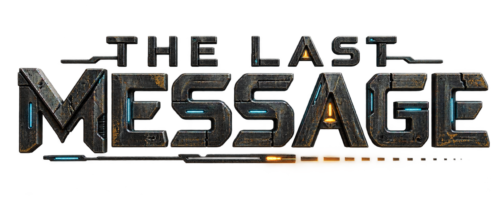
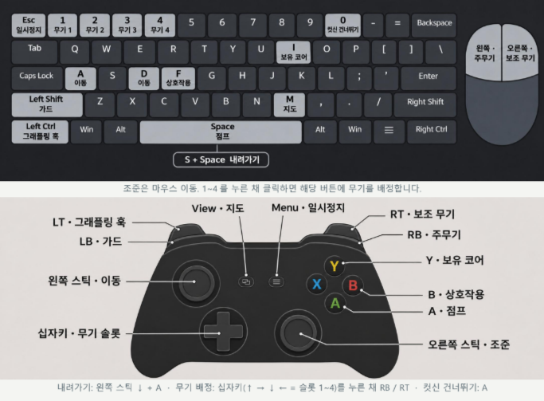
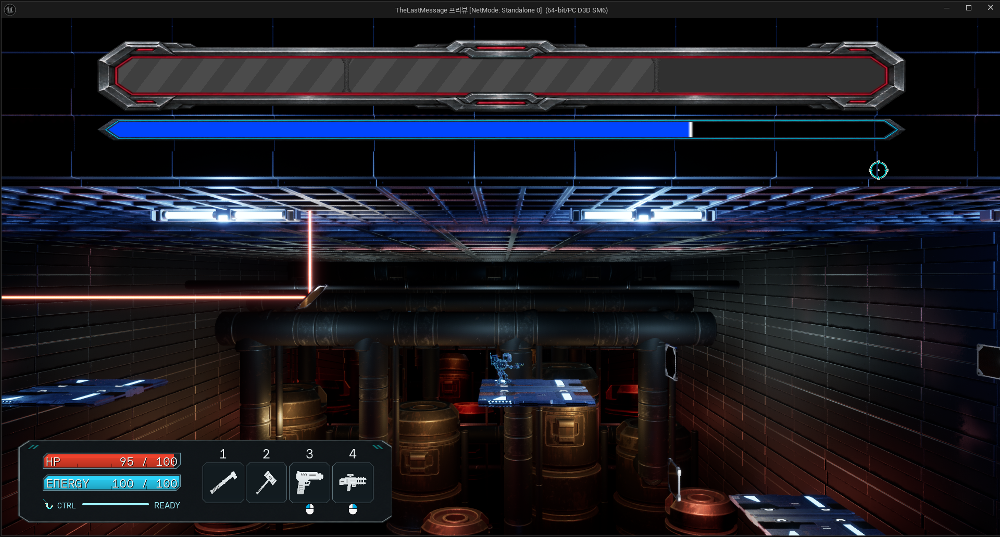
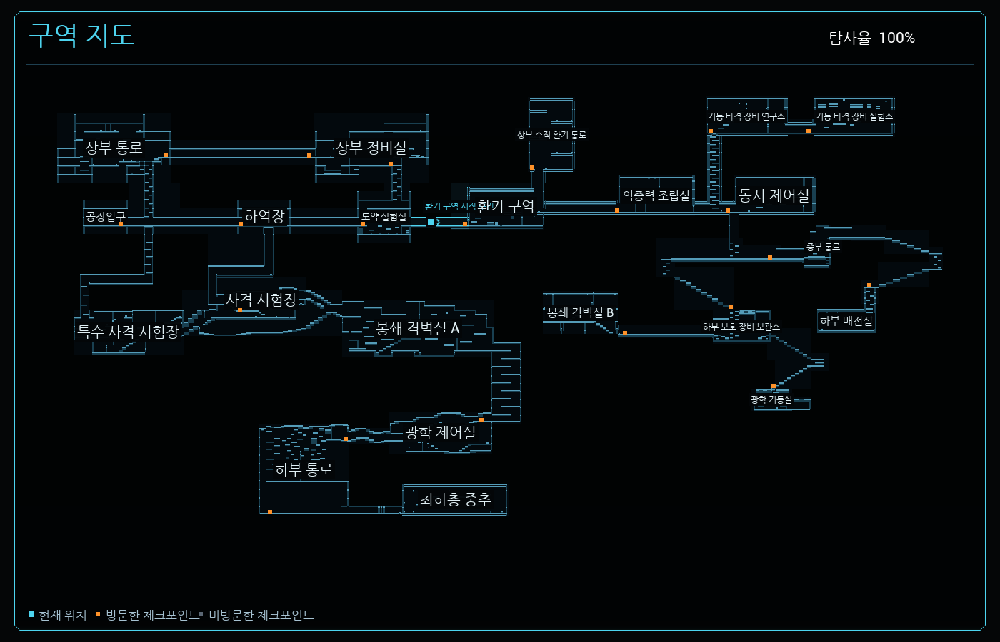

# The Last Message


[](https://github.com/danger10043/TheLastMessage/releases/latest)

[](https://www.youtube.com/watch?v=8Y0GvvK_usM)
[](https://app.notion.com/p/3f17bd5c987980fa9c0ef7ca058c1daf?source=copy_link)



**폐쇄된 로봇 공장과 연구시설을 탐사하는 싱글 플레이 2.5D 메트로배니아 액션 게임**

공장 통로와 실험 구역을 오가며 로봇과 싸우고, 시설에 남은 장치를 조작해 다음 구역으로 향하는 길을 엽니다. 탐사와 전투에서 획득한 무기와 코어를 활용해 전투 방식을 바꾸고, 구역 지도에서 현재 위치와 체크포인트 방문 상태를 확인할 수 있습니다.

## 영상

| 티저 영상 | 플레이 영상 |
| --- | --- |
| [](https://youtu.be/ZTZcqHGBABo) | [](https://youtu.be/8Y0GvvK_usM) |

## 다운로드

[GitHub 최신 릴리스](https://github.com/danger10043/TheLastMessage/releases/latest)의 **Assets**에서 배포 파일을 확인할 수 있습니다.

## 게임 매뉴얼

[매뉴얼 보기 (PDF)](Content/ReadmeMedia/TheLastMessage_Manual.pdf) · [PDF 다운로드](Content/ReadmeMedia/TheLastMessage_Manual.pdf?raw=1)

## 조작 방법



## 주요 시스템

| 시스템 | 게임플레이 |
| --- | --- |
| 탐사 | 그래플링 훅과 이동 기믹을 활용해 높이가 다른 통로를 오가고, 방문한 구역을 지도에서 확인합니다. |
| 전투 | 근접·원거리 무기로 로봇을 상대하고, 코어의 방어·회복·지원 능력을 활용합니다. |
| 공장 퍼즐 | 레이저를 반사하거나 퓨즈로 회로를 연결하고, 발판에 물체를 올리거나 정해진 순서대로 스위치를 조작합니다. 환풍기의 상승 기류와 중력 반전 발판으로 이동 경로를 바꾸고, 폭탄을 밀어 장애물을 부숩니다. |
| 보스전 | 보스의 페이즈에 따라 달라지는 공격 패턴과 실드 기믹에 대응합니다. |
| 지도와 체크포인트 | 지도에 현재 위치와 체크포인트 방문 여부를 표시합니다. 체크포인트에서 진행 상황을 저장하고 재시작 시 복원합니다. |

## 게임플레이 화면 예시 [보스 전투]

### 전투 HUD와 레이저 반사 기믹



### 구역 지도



## 기술 구성

Unreal Engine 5.8에서 C++과 Blueprint로 구현했습니다. 전투 능력과 속성은 Gameplay Ability System(GAS)으로 처리하고, 무기와 코어 설정은 Data Asset으로 관리합니다. 환경 기믹 설정에는 Data Table을 사용하고, 지도와 메뉴 화면은 UMG 위젯으로 구성합니다.

| 구현 영역 | 관련 코드 |
| --- | --- |
| 전투 · 코어 | [GAS](Source/TheLastMessage/Private/GAS/) · [무기](Source/TheLastMessage/Private/Weapon/) · [코어](Source/TheLastMessage/Private/Core/) |
| 적 · 보스 AI | [일반 적](Source/TheLastMessage/Private/Character/Enemy/) · [보스](Source/TheLastMessage/Private/Character/Boss/) |
| 퍼즐 · 환경 상호작용 | [Gimmick](Source/TheLastMessage/Private/Gimmick/) |
| 지도 · 방 스트리밍 · 진행 저장 | [Map](Source/TheLastMessage/Private/Map/) · [Checkpoint](Source/TheLastMessage/Private/Checkpoint/) · [Save](Source/TheLastMessage/Private/Save/) |
| UI | [C++ 위젯](Source/TheLastMessage/Private/UI/) · [UMG 에셋](Content/Main/UI/) |

[기술문서 보기 (PDF)](Content/ReadmeMedia/TheLastMessage_Technical.pdf) · [PDF 다운로드](Content/ReadmeMedia/TheLastMessage_Technical.pdf?raw=1)

## 에디터에서 실행

1. Windows에 Unreal Engine 5.8과 Visual Studio의 **C++를 사용한 게임 개발** 워크로드를 설치합니다. 프로젝트의 [`.vsconfig`](.vsconfig)를 가져와 구성 요소를 설치할 수 있습니다.
2. 저장소를 클론하고 프로젝트 폴더로 이동합니다.

   ```bash
   git clone https://github.com/danger10043/TheLastMessage.git
   cd TheLastMessage
   ```

3. [`TheLastMessage.uproject`](TheLastMessage.uproject)를 엽니다. 프로젝트 모듈 빌드 안내가 나오면 빌드합니다.
4. 기본 시작 맵 `LV_MainMenu`에서 에디터 상단의 **Play**를 누르면 메인 메뉴에서 시작합니다.
